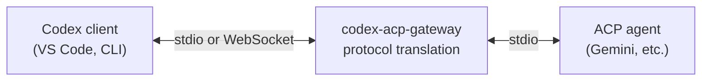
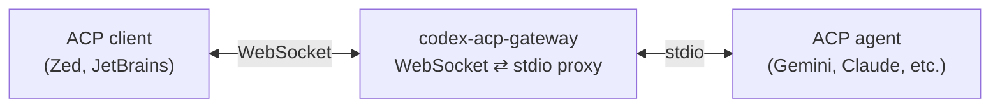

# codex-acp-gateway

A protocol translation gateway and WebSocket proxy for
[ACP](https://agentclientprotocol.com/) (Agent Client Protocol) agents.

The gateway operates in two modes:

- **`codex` mode** — Translate between [Codex](https://github.com/openai/codex)
  app-server protocol and ACP, so any Codex client can use any ACP agent.
- **`acp-proxy` mode** — Expose any stdio-based ACP agent over WebSocket, so
  remote ACP clients (Zed, JetBrains, Neovim, etc.) can reach it over the
  network.

#### Codex mode



#### ACP proxy mode



## Why

Codex has a rich ecosystem of clients (VS Code extension, CLI, web). ACP is an
emerging open protocol backed by Google, Zed, and others that many agents are
adopting. This gateway lets you use any ACP agent as the backend for any Codex
client without modifying either side.

The ACP proxy mode is useful when you want to expose a local ACP agent (which
normally communicates over stdio) to remote clients over WebSocket — for
example, running a Gemini or Claude Code agent on a dev server and connecting
to it from an editor on another machine.

## Installation

```bash
# Clone and build
git clone https://github.com/mmonad/codex-acp-gateway.git && cd codex-acp-gateway
cargo build --release

# Binary is at target/release/codex-acp-gateway
```

Requires Rust 2024 edition (1.85+).

## Usage

### Codex mode (default)

Translate between Codex app-server protocol and ACP:

```bash
# Stdio mode — pipe Codex protocol on stdin/stdout
codex-acp-gateway --agent-cmd <agent-binary> [-- agent-args...]

# WebSocket mode — accept Codex clients over WebSocket
codex-acp-gateway --listen ws://0.0.0.0:8080 --agent-cmd <agent-binary> [-- agent-args...]

# Example: use Gemini as a Codex agent
codex-acp-gateway --agent-cmd gemini -- --experimental-acp
```

### ACP proxy mode

Expose any stdio-based ACP agent over WebSocket with no protocol translation —
the gateway just bridges WebSocket frames to stdin/stdout NDJSON. Each WebSocket
connection gets its own agent subprocess.

```bash
codex-acp-gateway --mode acp-proxy --listen ws://0.0.0.0:7003 \
  --agent-cmd <agent-binary> [-- agent-args...]
```

#### Example: Gemini over WebSocket

```bash
codex-acp-gateway --mode acp-proxy --listen ws://0.0.0.0:7003 \
  --agent-cmd gemini -- --experimental-acp
```

#### Example: Claude Code over WebSocket

Claude Code does not natively support ACP, but the
[claude-agent-acp](https://github.com/zed-industries/claude-agent-acp) adapter
(by Zed Industries) wraps the Claude Code CLI as an ACP agent.

Install the adapter:

```bash
npm install -g @zed-industries/claude-agent-acp
```

Then run the gateway:

```bash
codex-acp-gateway --mode acp-proxy --listen ws://0.0.0.0:7003 \
  --cwd ~/my-project \
  --agent-cmd claude-agent-acp
```

This spawns a `claude-agent-acp` subprocess for each WebSocket connection. The
adapter manages the Claude Code CLI internally — you need a working `claude`
installation and valid Anthropic credentials (via `ANTHROPIC_API_KEY` or
`claude /login`).

### Transport modes

The `--listen` flag controls how clients connect to the gateway:

| Value              | Behavior                                             |
|--------------------|------------------------------------------------------|
| `stdio://` (default) | Read/write on stdin/stdout. Single client, exit on EOF. |
| `ws://IP:PORT`     | Accept WebSocket connections. Each client gets its own ACP agent subprocess. |

### Options

- `--mode <MODE>` — `codex` (default) or `acp-proxy`
- `--agent-cmd` — path or name of the ACP agent binary to spawn
- `--listen <URL>` — transport endpoint (`stdio://` or `ws://IP:PORT`)
- `--cwd <PATH>` — working directory for the agent subprocess (default: `.`)
- `--log-level <LEVEL>` — `trace`, `debug`, `info`, `warn`, `error` (default: `info`)
- Everything after `--` is forwarded as arguments to the agent process

## Protocol mapping

| Codex (client -> server)             | Direction | ACP (client -> agent)           |
|--------------------------------------|-----------|---------------------------------|
| `initialize`                         |    -->    | `initialize`                    |
| `thread/start`                       |    -->    | `session/new`                   |
| `turn/start`                         |    -->    | `session/prompt`                |
| `turn/interrupt`                     |    -->    | `session/cancel`                |
| _item/* notifications_               |    <--    | `session/update` notifications  |
| `item/commandExecution/requestApproval` | <--    | `session/requestPermission`     |
| `item/fileChange/requestApproval`    |    <--    | `session/requestPermission`     |

ACP callbacks handled locally by the gateway (not forwarded to Codex):

| ACP callback             | Gateway behavior               |
|--------------------------|--------------------------------|
| `fs/readTextFile`        | Read file from local filesystem |
| `fs/writeTextFile`       | Write file to local filesystem  |
| `terminal/create`        | Spawn subprocess locally        |
| `terminal/output`        | Capture command output           |
| `terminal/release`       | Clean up subprocess              |
| `terminal/waitForExit`   | Wait for process completion      |
| `terminal/kill`          | Terminate subprocess             |

## Project structure

```
codex-acp-gateway/
  Cargo.toml                  Workspace root + gateway binary
  src/
    main.rs                   Entry point, CLI parsing, runtime setup
    lib.rs                    Module declarations, session orchestration
    config.rs                 CLI args and configuration (clap)
    error.rs                  Gateway error types
    acp_proxy.rs              ACP proxy mode (WS-to-stdio bridge, no translation)
    command_exec.rs           Sandbox-aware subprocess execution
    sandbox.rs                Bubblewrap (bwrap) sandbox integration
    transport/                Codex-side transport (stdio NDJSON + WebSocket)
    acp/                      ACP subprocess management + Client trait impl
    translation/              Bidirectional protocol translation engine
    rollout/                  Thread history persistence and listing
  crates/                     Vendored from codex (Apache-2.0), maintained locally
    app-server-protocol/      Codex wire types (JSON-RPC messages, v1/v2)
    protocol/                 codex-protocol (core domain types)
    codex-experimental-api-macros/
    execpolicy/               Sandbox execution policy
    file-search/              Fuzzy file search
    utils/                    Transitive deps (absolute-path, cache, image, git)
  docs/
    ARCHITECTURE.md           Deep technical architecture documentation
    GAP_ANALYSIS.md           Protocol coverage audit and known gaps
```

## Key dependencies

- **codex-app-server-protocol** (vendored) -- all Codex JSON-RPC request/response/notification types
- **agent-client-protocol** v0.9 (crates.io) -- official ACP Rust SDK (Agent + Client traits, wire types)
- **tokio** -- async runtime (full features)
- **serde** / **serde_json** -- serialization
- **clap** -- CLI argument parsing
- **tokio-tungstenite** -- WebSocket transport
- **tracing** -- structured logging
- **uuid** v7 -- correlation IDs

## License

Apache-2.0
